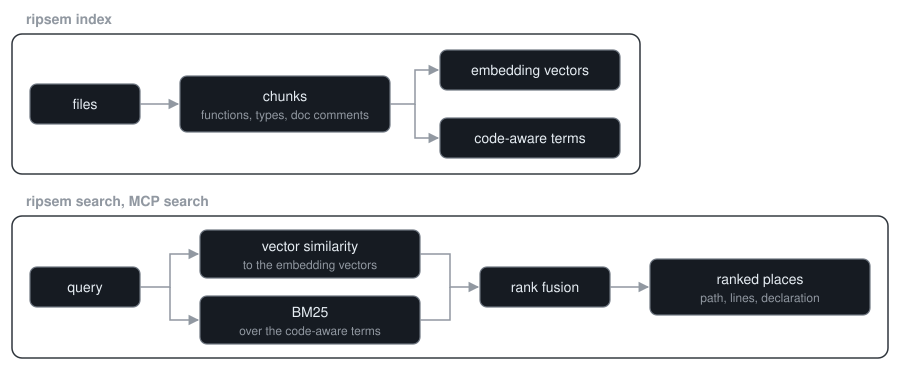

<h1 align="center">ripsem</h1>

<p align="center"><i>Where is the code that does this?</i></p>

<p align="center">
  <a href="https://github.com/Sadykhzadeh/ripsem/actions/workflows/ci.yml"></a>
  <a href="https://github.com/Sadykhzadeh/ripsem/releases/latest"></a>
  <a href="LICENSE"></a>
</p>

<p align="center">
  <a href="#get-started">Get started</a> ·
  <a href="#usage">Usage</a> ·
  <a href="#use-with-coding-agents">Coding agents</a> ·
  <a href="#how-it-works">How it works</a> ·
  <a href="#troubleshooting">Troubleshooting</a>
</p>

<p align="center">
  <picture>
    <source media="(prefers-color-scheme: light)" srcset="https://github.com/Sadykhzadeh/ripsem/raw/HEAD/docs/demo/search-light.gif">
    
  </picture>
</p>

ripsem is local, offline code search for people and for coding agents. Ask with
an identifier, an error message or a plain description of the behaviour, and get
back the functions and types that answer it, ranked, with their names and line
ranges.

- **Every shape of question in one query.** BM25 over code-aware tokens and
  vector similarity from a local embedding model, merged into one ranking. A
  chunk holding every term of an identifier or an error message comes first.
- **Answers are declarations.** A hit is a whole function or type, named after
  it, in 17 languages, so a definition reads apart from a call site. A search
  for a name lands on its declaration, with its own lines and label.
- **Made for coding agents.** `ripsem install claude-code`, `cursor`, `vscode`,
  `gemini`, `opencode` or `codex` adds an MCP server that keeps its index current while the agent
  edits, and tells the agent when to use it.
- **Offline.** No account, no API key, no service. The model downloads once and
  runs on your CPU, and the index is one file inside your repository.

## Get started

1. Install ripsem:

    **npm (any platform):**
    ```bash
    npm install -g ripsem
    ```

    **Cargo:**
    ```bash
    cargo install --locked ripsem
    ```

    **macOS and Linux, without npm or Rust:**
    ```bash
    curl -fsSL https://raw.githubusercontent.com/Sadykhzadeh/ripsem/master/install.sh | sh
    ```

    **Windows, without npm or Rust:**
    ```powershell
    irm https://raw.githubusercontent.com/Sadykhzadeh/ripsem/master/install.ps1 | iex
    ```

2. In your repository, ask it something:

    ```bash
    ripsem search "strip the auth header when redirecting to another host"
    ```

3. Hand the same search to your coding agent with `ripsem install claude-code`,
   `ripsem install cursor`, `ripsem install vscode`, `ripsem install gemini` or
   `ripsem install opencode` or `ripsem install codex` (see
   [below](#use-with-coding-agents)).

The first search in a git repository, or in a directory where `ripsem init`
has run, builds the index: it downloads the model (~133 MB) once and embeds the
repository. Every search after that first embeds whatever changed since, so
results never point at code that has moved. On Windows the first index runs on
the GPU through DirectML when there is one.

To try it without the download, switch to the hashing backend before the first
index. It matches the words of a query rather than its meaning:

```bash
ripsem model backend hash && ripsem index --force
```

### Why not grep?

grep answers "where does this string occur". That is the right question when you
know the string. ripsem is for when you know what the code does but not what it
is called: a description finds the function, and an identifier or an error
message still finds its exact match, because the lexical arm sees it
literally. Each hit is a whole function or type with its name, not a matching
line, so a reader or an agent can tell a definition from a call site without
opening the file.

## Install

npm and the install scripts put the prebuilt binary from the latest
[release](https://github.com/Sadykhzadeh/ripsem/releases) on your `PATH`, after
checking it against the release's `SHA256SUMS`. The scripts install to
`~/.local/bin` and `%LOCALAPPDATA%\Programs\ripsem`; `RIPSEM_INSTALL_DIR`
overrides that. The release archives can also be unpacked by hand; on Windows,
keep `DirectML.dll` next to `ripsem.exe`.

| platform | runs on |
| --- | --- |
| `x86_64-unknown-linux-gnu` | glibc 2.35, libstdc++ 12 and OpenSSL 3 or newer: Ubuntu 22.04, Debian 12 and later |
| `aarch64-unknown-linux-gnu` | glibc 2.39, libstdc++ 14 and OpenSSL 3 or newer on 64-bit Arm: Ubuntu 24.04, Debian 13 and later, such as on AWS Graviton; from the install script or the archive, not npm yet |
| `aarch64-apple-darwin` | macOS 13.4 or newer on Apple silicon |
| `x86_64-pc-windows-msvc` | Windows 10 or newer with the [Microsoft Visual C++ Redistributable](https://learn.microsoft.com/cpp/windows/latest-supported-vc-redist) |

The embedding runtime in the x86-64 builds needs a CPU with AVX2 (Intel
Haswell, AMD Excavator or newer). The binaries are built with the embedding
runtime and tree-sitter; the model itself downloads on first use.

`cargo install` builds from source, with Rust 1.92 or newer. The build
downloads a prebuilt ONNX Runtime, and needs a C and C++ compiler, plus
pkg-config and the OpenSSL headers on Linux (`build-essential pkg-config
libssl-dev` on Debian and Ubuntu).

Tagged releases are the stable versions, and npm, Cargo and the install scripts
all install the latest one. `master` carries the changes for the next release,
listed under Unreleased in [CHANGELOG.md](CHANGELOG.md).

To build the latest release from a checkout:

```
git clone https://github.com/Sadykhzadeh/ripsem
cd ripsem
git checkout "$(git describe --tags --abbrev=0)"
cargo install --locked --path .
```

Leaving out the `git checkout` builds `master`.

The `fastembed` feature, on by default, pulls in the local embedding runtime.
Built with `--no-default-features`, ripsem runs on a lightweight hashing backend
that matches words instead of meaning, which is what the test suite uses. It
ranks by the words of the query alone, as the lexical arm does.

The `treesitter` feature, also on by default, chunks code on function and type
boundaries instead of fixed line windows, and names each chunk after the
declaration it belongs to. A function or method is a chunk of its own however
small; a class or `impl` is cut into its members; other small declarations and
the lines between declarations are grouped, and a fragment of a line or two
joins its neighbour. Results look like
`src/auth/session.rs:40-72 fn Session::refresh`, so a caller can tell a
definition from a call site without opening the file. A function too large for
one chunk passes its name to every piece. It covers Rust, Python, JavaScript,
TypeScript, Go, Java, C, C++, C#, Ruby, PHP, Scala, Kotlin, Bash, HTML, CSS and
JSON; other files are cut into line windows.

The `hnsw` feature adds an approximate-nearest-neighbour graph for indexes above
500 000 chunks. It changes only how the vector arm gathers candidates; the
lexical arm and the merge work the same at any size.

### Shell completions

```
ripsem completions bash > ~/.local/share/bash-completion/completions/ripsem
ripsem completions zsh > ~/.zfunc/_ripsem
ripsem completions fish > ~/.config/fish/completions/ripsem.fish
ripsem completions powershell >> $PROFILE
```

## Usage

```
ripsem init                       # write .ripsem/config.toml
ripsem index                      # build the index (incremental on re-runs)
ripsem search "where is auth set up?"   # updates the index first
ripsem similar src/auth.rs:40-72  # the code nearest to a location, no model run
ripsem status                     # index size, counts, model, drift from the tree
ripsem status --json              # the same as JSON (schema ripsem/status/v1)
ripsem status --verify            # also read every indexed file and list the ones that changed
ripsem watch                      # keep the index in sync as files change
```

Like git, every command except `init` works from any subdirectory: it uses the
nearest parent that holds a `.ripsem` directory. `--path <dir>` overrides that.
`init` in a subdirectory of an indexed project creates a second index there,
which hides the parent's index from every command run in that subdirectory.
It warns when that happens; delete the subdirectory's `.ripsem` to go back.

The index stays out of git: `.ripsem/.gitignore` lists it, so `git status`
shows only `config.toml` (which can be committed) and that `.gitignore`. ripsem
writes the file when it is missing and never changes an existing one.

`status` also reports how far the index has drifted from the files. Hits carry
the line range their file had when it was indexed, so `tree: out of date: 3
changed, 1 new` tells you when a result may no longer point at the right lines.
Drift is measured the way the incremental index finds changes, so it counts
exactly what a rebuild would touch. The JSON carries it as `index.drift`
(`added`/`modified`/`removed`). `built:` says when the index file was last
written, and the JSON carries the same time as `index.written_unix`.

Results print as `path:start-end` with the declaration's name and a snippet, in
merged-ranking order. The first three hits carry their code, up to 40 lines,
so the answer can be read without opening the file. Records that cover the same lines (a declaration and the
documentation above it, or adjacent windows) are returned once, so `-k 5` means
five distinct places. The number shown runs from 0 to 1: how far the hit's
meaning rises above unrelated text in this repository, or the share of the
query's terms found literally, whichever is higher. It never rises down the
list, so a threshold keeps the top of the ranking. Each index measures its own
noise floor by matching queries about anything but code against it, so the
scale follows the repository and the model.

The words of a query need no quotes: `ripsem search where is auth set up`
asks the same as `ripsem search "where is auth set up"`. A query can also come
from stdin, with `ripsem search -`, or with no words when stdin is not a
terminal; one trailing line break is not part of it:

```
$ echo verify_password | ripsem search - -k 2 --context 0
src/login.rs:1-3  fn login  (1.000)

src/table.rs:1-3  fn render_table  (0.002)

more results below this; pass --offset 2 to see them
```

- `-k <N>` sets the number of results (default 10).
- `--offset <N>` skips the first N results, counted in the ranking after every
  filter and `--min-score`, to read the next page. When more results follow,
  the output ends with `more results below this; pass --offset 10 to see
  them`. An offset past the last result prints `no further matches`. The
  ranking is made again for each page, so a page reads the same as the
  matching stretch of one larger `-k` except where a deeper search finds a
  chunk that holds every term of the query.
- `--json` prints the hits as a JSON array. Each has `path`, `start_line`,
  `end_line`, `score`, `kind` and `symbol` (such as `fn` and
  `Session::refresh`, both `null` for a hit outside any declaration),
  and `snippet`. With `--offset` the array holds that page; a page shorter
  than `-k` is the last one. With `--count-by-file` each entry is a `path`
  and its `count`.
- `--in <subdir>` limits results to a subdirectory. A relative path starts
  from the current directory, as in the shell: in `src`, `--in auth` means
  `src/auth` and `--in .` means `src`. An absolute path into the repository
  works too.
- `-t, --lang <LANG>` (also `--type`) keeps only hits in files of that language,
  by name or by extension: `--lang rust`, `-t py`, `--lang toml`. Repeat the flag
  or separate values with commas for several: `--lang rust,toml`.
- `-g, --glob <GLOB>` keeps only hits whose path matches, as ripgrep's `-g`
  does, and a leading `!` leaves matching paths out: `-g '*.rs' -g
  '!*_test.rs'`. A directory counts for the files inside it, so
  `-g '!vendor/'` skips all of `vendor`. Repeat for several.
- `-e, --regex <PATTERN>` keeps only hits whose code matches the regular
  expression, for "the place that does X and mentions `foo`":
  `ripsem search retry on failure -e 'backoff|jitter'`. The pattern uses the
  Rust regex syntax and is matched against each hit's whole chunk, not just
  the snippet shown; `(?i)` ignores case. It applies before the ranking is cut
  and goes with `--lang`, `--glob`, `--in`, `--min-score` and `--offset`, but
  it is tried on the 200 best-ranked places only (more when `-k` and
  `--offset` reach further), because chunk text is read from the files rather
  than held in the index. It narrows an answer; for every occurrence of a
  string use grep. A pattern that does not parse, or compiles to more than 1
  MiB, is an error.
- `--context <N>` sets how many snippet lines print per hit (3 in a terminal,
  the whole snippet when the output goes to another program; `0` prints just
  the locations).
- `--color <auto|always|never>` colours the path and the line numbers of each
  hit. `auto`, the default, colours a terminal and leaves output piped to
  another program plain; a `NO_COLOR` set to anything but an empty string
  turns it off.
- `--min-score <SCORE>` keeps only strong matches, in both human and JSON output.
- `-c, --count-by-file` prints hit counts per file instead of the hits.
- `-q, --quiet` prints nothing and sets the exit status: 0 when a hit is left
  after the filters and `--min-score`, 1 when none is, so a script can branch
  on a match. Without it a search with no hits still exits 0.
- `-l, --files-with-matches` lists each file with a hit once, in the order of
  its best hit, instead of the hits. It cannot be combined with
  `--count-by-file`. With `--json` it prints a JSON array of the paths as
  strings, not of hits.
- `-0, --null` ends each path listed by `-l` with a NUL byte instead of a line
  break, so `ripsem search --files-with-matches -0 'retry' | xargs -0 wc -l`
  reads paths with spaces or newlines whole. It needs `-l` and cannot be
  combined with `--json`.
- `--vimgrep` prints one `path:line:column:text` line per hit, the format
  quickfix lists and grep tools read. Column is 1 and text is the hit's first
  non-blank line. It cannot be combined with `--json`, `-l`, `-q` or
  `--count-by-file`. In Vim or Neovim:

  ```vim
  " load the hits into the quickfix list
  :cexpr system('ripsem search --vimgrep -k 50 retry on failure')
  :copen
  ```
- `--since <REV>` keeps only hits in files that differ from a git revision,
  as the working tree has them: committed, staged and unstaged changes, and
  untracked files. `ripsem search --since main 'retry on failure'` reviews a
  branch. It needs a git repository and reads git with its own arguments.
- `--sort path` shows the hits of the page ordered by file and then by line,
  instead of by score. `--offset` still reads the ranking by score, so the
  page is the same set of hits either way.

`ripsem similar <path>[:LINE[-LINE]]` finds the code nearest to a place
already in the index: `ripsem similar src/auth.rs:40-72`, one line
`src/auth.rs:40`, or a bare path for the whole file. It reads the vectors the
index stores, so it runs no model and works offline. Its time is mostly loading
the index, not the search: 1.15 s at the fastest of five runs on 978 794 chunks
with the hashing backend. The lines asked about are left out of the answer. A whole file, or a range covering several chunks, is
looked for by the average of its chunks, so the query reads as what that code
is about rather than as its single best chunk. It takes the options of
`search` and refreshes the index first, as `search` does; an unknown path, a
line past the end of the file and a range that holds no indexed code are
errors.

## Exit codes

- `0`: the command ran. A search with no hits also exits 0, unless `-q` is
  given.
- `1`: the command failed while running, such as a missing index, a regex or
  glob that does not parse, or a path outside the repository. A `-q` search
  with no hit left also exits 1.
- `2`: the command line was not accepted, such as an unknown flag or a value
  out of range. The usage message goes to stderr.

## JSON output

`search`, `similar` and `status` print one JSON document with `--json`. The
tables below list every field with its type and meaning. A test runs each
command on a small repository and fails when the fields in a table and the
keys the command prints differ, so the tables stay true.

### `search`

The hits as an array, in the order `--sort` gives. Each element:

| Field | Type | Meaning |
| --- | --- | --- |
| `path` | string | The file, relative to the root, with forward slashes. |
| `start_line` | number | The first line of the hit, 1-based. |
| `end_line` | number | The last line of the hit, 1-based and inclusive. |
| `score` | number | From 0 to 1, as `--min-score` reads it. |
| `kind` | string or null | The declaration kind, such as `fn`; `null` outside any declaration. |
| `symbol` | string or null | The declaration's name, such as `Session::refresh`; `null` outside any declaration. |
| `snippet` | string | The code of the hit, the whole snippet. |

### `search --count-by-file`

An array with one element per file, sorted by count:

| Field | Type | Meaning |
| --- | --- | --- |
| `path` | string | The file, relative to the root. |
| `count` | number | The hits in that file among the top `-k` places. |

### `similar`

The hits nearest the place asked about, as an array in the order `--sort`
gives. Each element has the fields of `search`:

| Field | Type | Meaning |
| --- | --- | --- |
| `path` | string | The file, relative to the root, with forward slashes. |
| `start_line` | number | The first line of the hit, 1-based. |
| `end_line` | number | The last line of the hit, 1-based and inclusive. |
| `score` | number | How near the hit is to the place asked about, from 0 to 1. |
| `kind` | string or null | The declaration kind, such as `fn`; `null` outside any declaration. |
| `symbol` | string or null | The declaration's name, such as `Session::refresh`; `null` outside any declaration. |
| `snippet` | string | The code of the hit, the whole snippet. |

### `status`

One object. Fields under `index` describe the index file and are present while
it exists; `warning` appears only with the hashing backend.

| Field | Type | Meaning |
| --- | --- | --- |
| `schema` | string | The schema of this document, `ripsem/status/v1`. |
| `backend` | string | The embedding backend, `hash` or `fastembed`. |
| `model` | string | The embedding model the configuration names. |
| `dims` | number | The width of the vectors, in dimensions. |
| `warning` | string | Why hashing results match words, not meaning. |
| `index` | object | The index file and what it holds. |
| `index.path` | string | Where the index file is. |
| `index.present` | boolean | Whether the index file exists. |
| `index.size_bytes` | number | The size of the index file. |
| `index.written_unix` | number | When the index file was last written, in seconds since the Unix epoch. |
| `index.files` | number | The files the index holds. |
| `index.chunks` | number | The chunks the index holds. |
| `index.named` | number | The chunks that carry a declaration's name. |
| `index.ann` | boolean | Whether the index has a nearest-neighbour graph. |
| `index.backend` | string | The backend the index was built with. |
| `index.model` | string | The model the index was built with. |
| `index.stale` | boolean | Whether the index is behind the files it was built from. |
| `index.drift` | object | How far the files are from the index. |
| `index.drift.added` | number | Files on disk that the index does not hold. |
| `index.drift.modified` | number | Files both hold, with different content. |
| `index.drift.removed` | number | Files the index holds that are no longer on disk. |

### `status --verify`

`--verify` reads every indexed file and adds one more field, under `index`:

| Field | Type | Meaning |
| --- | --- | --- |
| `index.changed_on_disk` | array of strings | The indexed files whose content no longer matches the index, relative to the root. |

## Environment variables

ripsem reads these variables and no other `RIPSEM_` variable. A test fails when
this table and the variables the source reads differ.

| Variable | Default | Effect |
| --- | --- | --- |
| `RIPSEM_HASH_ALL` | unset | Set to `1` to read and hash every file on a run, instead of trusting the file times the index stored. Other values leave it off. |
| `RIPSEM_MODEL_DIR` | the platform cache directory, under `ripsem/models` | Where the embedding model files are kept, so they can live on another disk or in a CI cache. |
| `RIPSEM_NO_GPU` | unset | Set to any value to keep embedding on the CPU. Without it, a run that embeds 256 chunks or more asks for the GPU where the platform has one, DirectML on Windows. |
>
## Models

```
ripsem model list                 # show available models
ripsem model set bge-base-en-v1.5
ripsem index                      # rebuilds the index for the new model
```

| Model | Dims | Disk | Merged MRR@10, automatic / hand-written | Notes |
| --- | --- | --- | --- | --- |
| bge-small-en-v1.5 | 384 | ~133 MB | 0.425 / 0.397 | default |
| all-MiniLM-L6-v2 | 384 | ~90 MB | not measured | smallest and fastest to embed |
| bge-base-en-v1.5 | 768 | ~436 MB | not measured | larger English model |
| multilingual-e5-small | 384 | ~470 MB | not measured | queries and comments in other languages |
| nomic-embed-text-v1.5 | 768 | ~550 MB | not measured | larger English model, the most memory to index |
| jina-embeddings-v2-base-code | 768 | ~644 MB | 0.464 / 0.493 | trained on code in 30 languages; the best results measured, at the largest download and more time and memory to index |

The numbers are region-level MRR@10 of the merged ranking on the benchmark in
[`eval/`](eval/README.md): four projects (axum, scrapy, nest, caddy), 1,043
queries made from doc comments and 100 written by hand, averaged over the four
projects. The code model gains +0.043 (95% interval +0.032 to +0.054) on the
automatic queries and +0.096 (+0.040 to +0.158) on the hand-written ones over
the default, and its dense retriever alone goes from 0.478 to 0.649 and from
0.297 to 0.493. It costs more: a 644 MB download against 128 MB, an index
that takes about twice as long on a GPU (1.3 to 3 times in two runs here, axum
37 s against 18 s in the latest), 940 MB of memory while indexing on a GPU
against 460 MB, and 890 MB against 240 MB for each search, which takes about
0.75 s at the median against 0.4 s. The
default stays small; set the code model when the repository is large enough
for results to matter more than the first index.

The model downloads once on first use, then everything is offline.

## Use with coding agents

<p align="center">
  <picture>
    <source media="(prefers-color-scheme: light)" srcset="https://github.com/Sadykhzadeh/ripsem/raw/HEAD/docs/demo/setup-light.gif">
    
  </picture>
</p>

```
ripsem install claude-code        # .mcp.json and a note in CLAUDE.md
ripsem install cursor             # .cursor/mcp.json and a rule in .cursor/rules
ripsem install vscode             # .vscode/mcp.json and .github/copilot-instructions.md
ripsem install gemini             # .gemini/settings.json and a note in GEMINI.md
ripsem install opencode           # opencode.json and a note in AGENTS.md
ripsem install codex              # .codex/config.toml and a note in AGENTS.md
```

`install` registers the server, writes `.ripsem/config.toml`, and adds a short
note that tells the agent to reach for `search` before grepping. Restart the
agent in the directory and it can call `search` directly.

Running `install` again changes nothing. An agent config that is not plain JSON
(or TOML for Codex) is left as it is, comments and trailing commas included, and
the command names the file to fix before it is run again.

The server sends the same note as its MCP instructions. Claude Code loads the
descriptions of MCP tools only when the model looks a tool up, so the model
learns that `search` exists, and when to use it, from the instructions and the
note in `CLAUDE.md`.

`ripsem mcp` speaks MCP over stdio and exposes a `search` tool: a
`query`, and optionally a `path` to stay inside, a `lang` and a `glob` (each one
string or a list, as `--lang` and `--glob`), a `regex` (only hits whose code
matches it, as `--regex`; an invalid pattern is a tool error), a `limit` (default 5, at most
50), an `offset` (default 0) to skip results and read the next page, and a
`min_score`, and a `since` git revision (as `--since`: only files that differ
from it, untracked files included). When more results follow, the text ends with the line `More
results below this; pass offset=5 to see them.` A client on MCP revision
2025-06-18 or later also gets the hits as `structuredContent` (`hits` with
`path`, `start_line`, `end_line`, `score`, `symbol`, `snippet`, and
`next_offset`, `null` on the last page), described by the tool's
`outputSchema`. An `offset` past the last
result is an answer, not an error: `No further results`. An argument outside the schema comes back as a tool
error that names what is expected, so the agent can correct the call. The
`find_similar` tool is `ripsem similar` for the agent: a `path`, and optionally
`line` and `end_line` (the whole file when `line` is absent), returns the code
nearest to that place, with `limit`, `offset`, `min_score`, `lang`, `glob`,
`regex` and `since` as `search` takes them. Its errors are the CLI's messages, such as a
file that is not in the index or a line past its end. The `index_status` tool,
which takes no arguments, returns what `ripsem status
--json` prints (as structured content too, for revision 2025-06-18 and later)
plus `updating`, whether the server is indexing right now, so an
agent that finds nothing it expects can see whether the index exists and how
many files have changed since it was built. All the tools carry the standard
MCP annotations (`readOnlyHint` and `idempotentHint` true, `destructiveHint`
and `openWorldHint` false) and a title, so a client can run them without asking each
time. `search` refreshes ripsem's own index under `.ripsem/` before it
answers, and touches nothing else. In a
directory with a `.ripsem` directory the server keeps the index current by
itself: it builds the index on its first start and re-embeds the code the
agent changes. Running `ripsem index` once beforehand has the index ready
before the first search.

Any other MCP client takes the same entry in its own config:

```json
{
  "mcpServers": {
    "ripsem": { "command": "ripsem", "args": ["mcp"] }
  }
}
```

Without ripsem installed, the client can start it through npm with
`"command": "npx", "args": ["-y", "ripsem", "mcp"]`.

The server finds the index from the directory it starts in. To point it at a
repository elsewhere, add `"--path", "/path/to/repo"` to `args`; `install
cursor` and `install vscode` write `"--path", "${workspaceFolder}"`, which the
editor expands to the project. VS Code lists its servers under `servers`
rather than `mcpServers`. A client that shares its workspace roots, such as one that starts the
server from the home directory, points it at the project itself, and `--path`
overrides them.

## Configuration

`.ripsem/config.toml`:

```toml
backend = "fastembed"
model = "bge-small-en-v1.5"
chunk_lines = 40
chunk_overlap = 8
max_chunk_lines = 50
max_file_kb = 1024
skip_generated = true
exclude = []
```

`chunk_lines` and `chunk_overlap` size the line windows used for plain-text
files and languages without a parser. `max_chunk_lines` caps a single semantic
chunk; larger functions are split. A `chunk_overlap` set in the file must be
below both windows, or the config is refused; one left at its default is cut
to half of a smaller window, so `max_chunk_lines = 5` on its own works. After changing any of the three, the next
`ripsem index` cuts every file again and embeds only the chunks whose text
changed (on axum, `chunk_lines` from 40 to 30 embedded 50 of 4,213 chunks).
Files larger than `max_file_kb` are skipped. `exclude` takes gitignore-style
globs, on top of `.gitignore` and an optional `.ripsemignore`. Globs are
relative to the project root: `vendor` excludes the top-level directory, and
`/vendor` and `./vendor` mean the same, and `src/sub/` with a trailing slash
excludes that directory too. On Windows a backslash is a separator too, so
`vendor\third_party` is `vendor/third_party`. A glob cannot start with `!`;
put negations in `.ripsemignore`.
`backend = "hash"` matches words instead of meaning; builds without the
`fastembed` feature start with it.

The file may start with a UTF-8 byte order mark and may use CRLF line endings.
A file that is not UTF-8 is read as Windows-1252, and UTF-16 without a byte
order mark is read as text. A file that is mostly UTF-8 keeps its characters
around a stray byte, which becomes U+FFFD.
An unknown key, a value of the wrong type, a size of 0 and a `model` that is
not in `ripsem model list` are all errors, and the message names the file and
the key. No environment variable sets a key in the file; `--path` picks the
project. The variables that change a run are `RIPSEM_HASH_ALL`,
`RIPSEM_NO_GPU` and `RIPSEM_MODEL_DIR`, each described where it applies.

`skip_generated` leaves out files that are committed but written by a machine:
lock files, `go.sum`, `*.min.js`, `*.min.css` and source maps. `.gitignore`
does not cover them because they are committed on purpose, and a single lock
file can outweigh everything written by hand. Set it to `false` to index them
anyway.

## How it works

<p align="center">
  <picture>
    <source media="(prefers-color-scheme: light)" srcset="https://github.com/Sadykhzadeh/ripsem/raw/HEAD/docs/how-it-works-light.svg">
    
  </picture>
</p>

1. **Walk.** The tree is read the way git sees it: `.gitignore`, the global
   gitignore and `.ripsemignore` apply, and binary files, files above
   `max_file_kb` and machine-written files are left out.
2. **Chunk.** tree-sitter cuts each file at function and type boundaries and
   names every chunk after its declaration. A function or method is a chunk
   of its own however few lines it has, a class or `impl` is cut into one
   chunk per member, and what is no declaration is grouped up to
   `max_chunk_lines`. A doc comment or docstring becomes a second record for
   the same declaration, because an author describes code in words the code
   itself rarely uses. Markdown is cut at its headings, so a hit starts at
   the heading that says what the text is about and a code block in it stays
   whole.
3. **Embed and tokenise.** Each chunk gets a vector from the local model, read
   under its file's path and its declaration's qualified name (`src/io.ts: fn
   IoAdapter::mapPayload`), so a method cut out of its class still says what it
   belongs to. The vector is stored as int8, next to a set of terms in which
   identifiers are kept whole and also split at `snake_case` and `camelCase`
   boundaries. Every chunk also lists the declarations it holds, with their
   lines.
4. **Search.** The query runs through both arms and their rankings are merged
   by reciprocal rank fusion. With the hashing backend the vectors do not
   vote, since they only record which words occur: the lexical arm ranks, and
   the vectors place whatever no word matched. A chunk holding every informative term of the
   query comes first, which is what makes identifiers and error messages
   reliable. A query that names a declaration, typed as code or spelled out in
   words, puts the chunk declaring it above the chunks that only use it, and
   reports that declaration. Below that, code ranks above tests, unless the
   query asks for tests, and above prose that describes it.
5. **Keep up.** The index is one file, `.ripsem/index.bin`. A re-run reads only
   files whose content changed and embeds only the chunks whose text changed;
   a new model or new chunk settings rebuild it.
   `ripsem watch` keeps it current as files change, and the MCP server picks up
   a rebuilt index without a restart.

## Troubleshooting

**A file never shows up in results.** `ripsem index --dry-run` lists every file
the index takes in, and says how many it left out and why. A file is left out when `.gitignore`, `.ripsemignore` or
`exclude` matches it, when it is binary, a minified bundle (at least 8 KiB with
lines averaging 4 KiB or more), or larger than `max_file_kb`, or when
`skip_generated` treats it as machine-written.

**A result points at the wrong lines.** The file changed after it was indexed.
`ripsem search` updates the index before it searches, and `ripsem watch` or a
running MCP server keeps it current; `ripsem status` shows how far it has
drifted.

**An edited file is not picked up.** A file whose size and modification time
are what they were when it was indexed is not read again, by `index`, `search`,
`watch`, the MCP server or `status`, so a file rewritten with different
contents, the same size and the same modification time is not seen as changed.
`search` does not print the old text of such a file: before it prints a hit, it
checks the file's hash against the index, and when they differ it reads that
file again and searches once more. The MCP server leaves such hits out without
reading the file, until a `ripsem search` or `ripsem index --force` run reads
it. Set `RIPSEM_HASH_ALL=1` for a run (`RIPSEM_HASH_ALL=1 ripsem status` shows
what is out of date) or run `ripsem index --force` to read every file.
`ripsem status --verify` reads the indexed files and lists the ones whose
content differs from the index, the same-size rewrites included; a file that is
gone is listed too.

**Search says the index was built with another model.** The config names a
different model or backend than the index. `ripsem index` rebuilds it for the
config.

**The agent does not call `search`.** The server starts with the agent, so
restart the agent in the repository after `install`. In Claude Code, `/mcp`
lists the servers it has connected to.

**The first index takes a while.** It downloads the model once and embeds every
file, showing the chunks embedded so far and an estimate of the time left.
Every later run embeds only the code that changed. On Windows a job of 256
chunks or more runs on the GPU through DirectML, about three times faster than
on the CPU (indexing axum took 17 s against 61 s, on a mid-range GPU against a
6-core CPU); `RIPSEM_NO_GPU=1` keeps it on the CPU, for example when a graphics
driver misbehaves. The model is cached in
`~/.cache/ripsem` on Linux, `~/Library/Caches/ripsem` on macOS and
`%LOCALAPPDATA%\ripsem\cache` on Windows; `RIPSEM_MODEL_DIR` names another
directory for it.

**`ripsem.exe` fails to start on Windows.** A missing `VCRUNTIME140.dll` or
`MSVCP140.dll` means the Microsoft Visual C++ Redistributable is not installed:
`winget install Microsoft.VCRedist.2015+.x64` adds it. A missing `DirectML.dll`
means it was not kept next to `ripsem.exe` when the archive was unpacked.

## How well it finds things

The benchmark in [`eval/`](eval/README.md) runs the real `ripsem search`
against four pinned projects (axum, scrapy, nest and caddy), with 1,043
questions made from the first sentence of a function's doc comment (the comment
is cut out of the indexed copy) and 100 written by hand, without naming the
answer. A result counts when it is in the file of the answer (file) or covers
the answer's lines (place). The table is MRR@10, which is 1.0 when the answer
is always first and 0.5 when it is second on average, and in brackets the share
of questions with the answer in the first ten results, averaged over the four
projects.

| | Hand-written, place | Hand-written, file | Automatic, place | Automatic, file |
| --- | --- | --- | --- | --- |
| Default model | 0.397 (68%) | 0.587 (86%) | 0.425 (74%) | 0.703 (91%) |
| Code model (`jina-embeddings-v2-base-code`) | 0.493 (77%) | 0.673 (87%) | 0.464 (80%) | 0.715 (93%) |
| Hash backend (words only) | 0.326 (47%) | 0.478 (70%) | 0.349 (59%) | 0.652 (87%) |
| ripgrep on the question's words | 0.103 (29%) | 0.103 (29%) | 0.168 (41%) | 0.169 (42%) |

In plain words: with the default model the right file is among the first ten
results for about nine automatic questions in ten and about eight and a half
hand-written ones in ten, and the right lines for about three in four and two
in three. The right file is usually, not always, the first or second one. The
code model finds clearly more of the hand-written questions, the ones that read
like a person asking, and a little more of the automatic ones. The hash backend
matches words only and is behind on both; ripgrep with the same words, which is
what a keyword search does with a question, is far behind. Searching takes
about 0.4 s with the default model, and building an index takes 18 s for axum
(487 files) and 78 s for nest (2,798 files) on a GPU.

What it does not show: four projects in four languages, 100 hand-written
questions (their 95% interval is about 0.08 wide on either side, so a gap of
0.05 between two rows is not a difference), and questions written by one person
or taken from comments, not from the questions your team asks. Counting a hit
by the lines it covers favours large chunks, so the file columns are the ones
to compare across versions of ripsem. To run it yourself, see
[`eval/README.md`](eval/README.md).

## Quality

Ranking is held to a benchmark of labelled questions over four real projects in
four languages (Rust, Python, Go and TypeScript), each pinned at a release tag.
The questions come in the four shapes people actually search with: a
description in their own words, an identifier, a message seen in output, and a
name remembered wrong. The merged ranking has to beat either retriever alone,
put the answer's file in the top five for at least 86% of its 73 questions,
and cost less to read up to the answer than the file the answer is in. Those
are file-level questions over a small set; the section above measures more. A second test searches
for every name declared once in those projects: the first hit has to be that
declaration, under its own name, for at least 95% of them, and no hit on a
declaration's lines may carry another name.

```
cargo test --release --test retrieval_quality -- --ignored --nocapture \
  fusion_beats_either_retriever_alone a_declared_name_leads_to_its_declaration
```

The first run clones the four projects into `target/corpora` and downloads the
model. [CONTRIBUTING.md](CONTRIBUTING.md) describes how a change to ranking is
measured.

## License

Apache-2.0
