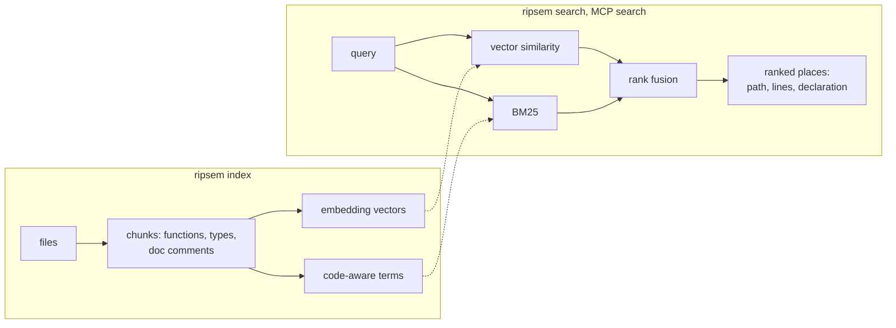

# ripsem

[](https://github.com/Sadykhzadeh/ripsem/actions/workflows/ci.yml)
[](LICENSE)

Local, offline code search that answers one question: where is the code that
does this? Ask with an identifier, an error string, or a plain description of
the behaviour. One query, one ranked answer. No account, no API key, and
nothing leaves the machine. Embeddings run on a model stored on your disk, and
the index is a single file inside your repo.

Every query runs through two independent retrievers and their rankings are
merged: BM25 over code-aware tokens, and vector similarity from the embedding
model. A literal identifier match cannot be lost to semantic distance, and a
question with no shared words still finds the right function.


## Quick start

```
cd your-repo
ripsem index
ripsem search "strip the auth header when redirecting to another host"
```

The first `index` downloads the model (~133 MB) and embeds the repository;
later runs re-embed only files that changed. `ripsem install claude-code` hands
the same search to a coding agent (see [below](#use-with-coding-agents)).

### Why not grep?

grep answers "where does this string occur". That is the right question when you
know the string. ripsem is for when you know what the code does but not what it
is called: a description finds the function, and an identifier or an error
message still finds its exact match, because the lexical arm sees it
literally. Each hit is a whole function or type with its name, not a matching
line, so a reader or an agent can tell a definition from a call site without
opening the file.

## Install

Every [release](https://github.com/Sadykhzadeh/ripsem/releases) has a prebuilt
binary for each platform below, built with the embedding runtime and
tree-sitter (the model itself downloads on first use), and a `SHA256SUMS` file
to check the archives against. Unpack one and put `ripsem` on your `PATH`; on
Windows, keep `DirectML.dll` next to `ripsem.exe`.

| archive | runs on |
| --- | --- |
| `x86_64-unknown-linux-gnu` | glibc 2.35, libstdc++ 12 and OpenSSL 3 or newer: Ubuntu 22.04, Debian 12 and later |
| `aarch64-apple-darwin` | macOS 13.4 or newer on Apple silicon |
| `x86_64-pc-windows-msvc` | Windows 10 or newer |

The embedding runtime in the x86-64 builds needs a CPU with AVX2 (Intel
Haswell, AMD Excavator or newer).

To build from source instead, with Rust 1.90 or newer:

```
cargo install --locked --git https://github.com/Sadykhzadeh/ripsem --features fastembed,treesitter
```

The build downloads a prebuilt ONNX Runtime. It needs a C and C++ compiler, plus
pkg-config and the OpenSSL headers on Linux (`build-essential pkg-config
libssl-dev` on Debian and Ubuntu).

To build from a checkout:

```
git clone https://github.com/Sadykhzadeh/ripsem
cd ripsem
cargo install --locked --path . --features fastembed,treesitter
```

The `fastembed` feature pulls in the local embedding runtime. Without it the
binary builds and runs on a lightweight hashing backend that matches words
instead of meaning, which is what the test suite uses.

The `treesitter` feature chunks code on function and type boundaries instead of
fixed line windows, and names each chunk after the declaration it belongs to.
Results look like `src/auth/session.rs:40-72 fn Session::refresh`, so a caller
can tell a definition from a call site without opening the file. A function too
large for one chunk passes its name to every piece. It covers Rust, Python,
JavaScript, TypeScript, Go, Java, C, C++, C#, Ruby, PHP, Scala, Kotlin, Bash,
HTML, CSS and JSON; other files are cut into line windows.

The `hnsw` feature adds an approximate-nearest-neighbour graph for indexes above
500 000 chunks. It changes only how the vector arm gathers candidates; the
lexical arm and the merge work the same at any size.

## Usage

```
ripsem init                       # write .ripsem/config.toml
ripsem index                      # build the index (incremental on re-runs)
ripsem search "where is auth set up?"
ripsem status                     # index size, counts, model, drift from the tree
ripsem status --json              # the same as JSON (schema ripsem/status/v1)
ripsem watch                      # index and keep it in sync as files change
```

Like git, every command except `init` works from any subdirectory: it uses the
nearest parent that holds a `.ripsem` directory. `--path <dir>` overrides that.

The index stays out of git: `.ripsem/.gitignore` lists it, so `git status`
shows only `config.toml` (which can be committed) and that `.gitignore`. ripsem
writes the file when it is missing and never changes an existing one.

`status` also reports how far the index has drifted from the files. Hits carry
the line range their file had when it was indexed, so `tree: out of date: 3
changed, 1 new` tells you when a result may no longer point at the right lines.
Drift is measured with the same content hash the incremental index uses, so it
counts exactly what a rebuild would touch. The JSON carries it as `index.drift`
(`added`/`modified`/`removed`).

Results print as `path:start-end` with the declaration's name and a snippet, in
merged-ranking order. Records that cover the same lines (a declaration and the
documentation above it, or adjacent windows) are returned once, so `-k 5` means
five distinct places. The number shown is confidence in 0-1: semantic
similarity, or the share of the query's terms found literally, whichever is
higher.

- `-k <N>` sets the number of results (default 10).
- `--json` prints machine-readable output.
- `--in <subdir>` limits results to a subdirectory (`./src/auth` and an absolute
  path into the repository mean the same).
- `--context <N>` sets how many snippet lines print per hit (default 3; `0`
  prints just the locations).
- `--min-score <SCORE>` keeps only strong matches, in both human and JSON output.
- `--count-by-file` prints hit counts per file instead of the hits.

## Models

```
ripsem model list                 # show available models
ripsem model set bge-base-en-v1.5
ripsem index                      # rebuilds the index for the new model
```

| Model | Dims | Disk | Notes |
| --- | --- | --- | --- |
| bge-small-en-v1.5 | 384 | ~133 MB | default |
| all-MiniLM-L6-v2 | 384 | ~90 MB | smallest and fastest to embed |
| bge-base-en-v1.5 | 768 | ~436 MB | larger English model |
| multilingual-e5-small | 384 | ~470 MB | queries and comments in other languages |
| nomic-embed-text-v1.5 | 768 | ~550 MB | larger English model, the most memory to index |

The model downloads once on first use, then everything is offline.

## Use with coding agents


```
ripsem index
ripsem install claude-code        # writes ripsem into .mcp.json
ripsem install cursor             # writes ripsem into .cursor/mcp.json
```

`ripsem mcp` speaks MCP over stdio and exposes a single `search` tool: a
`query`, and optionally a `path` to stay inside, a `limit` (default 5) and a
`min_score`. After `install`, restart the agent in the directory and it can
call `search` directly. A running server picks up a rebuilt index by itself.
Any other MCP client takes the same entry in its own config:

```json
{
  "mcpServers": {
    "ripsem": { "command": "ripsem", "args": ["mcp"] }
  }
}
```

The server finds the index from the directory it starts in. To point it at a
repository elsewhere, add `"--path", "/path/to/repo"` to `args`; `install
cursor` writes `"--path", "${workspaceFolder}"`, which Cursor expands to the
project.

## Configuration

`.ripsem/config.toml`:

```toml
backend = "fastembed"
model = "bge-small-en-v1.5"
chunk_lines = 40
chunk_overlap = 8
max_chunk_lines = 50
max_file_kb = 1024
skip_generated = true
exclude = []
```

`chunk_lines` and `chunk_overlap` size the line windows used for plain-text
files and languages without a parser. `max_chunk_lines` caps a single semantic
chunk; larger functions are split. After changing any of the three, the next
`ripsem index` chunks and embeds every file again. Files larger than
`max_file_kb` are skipped. `exclude` takes gitignore-style globs, on top of
`.gitignore` and an optional `.ripsemignore`. `backend = "hash"` matches words
instead of meaning; builds without the `fastembed` feature start with it. A key
ripsem does not know is reported as an error.

`skip_generated` leaves out files that are committed but written by a machine:
lock files, `go.sum`, `*.min.js`, `*.min.css` and source maps. `.gitignore`
does not cover them because they are committed on purpose, and a single lock
file can outweigh everything written by hand. Set it to `false` to index them
anyway.

## How it works



1. **Walk.** The tree is read the way git sees it: `.gitignore`, the global
   gitignore and `.ripsemignore` apply, and binary files, files above
   `max_file_kb` and machine-written files are left out.
2. **Chunk.** tree-sitter cuts each file at function and type boundaries and
   names every chunk after its declaration. A doc comment or docstring becomes a
   second record for the same declaration, because an author describes code in
   words the code itself rarely uses.
3. **Embed and tokenise.** Each chunk gets a vector from the local model,
   stored as int8, and a set of terms in which identifiers are kept whole and
   also split at `snake_case` and `camelCase` boundaries.
4. **Search.** The query runs through both arms and their rankings are merged
   by reciprocal rank fusion. A chunk holding every informative term of the
   query comes first, which is what makes identifiers and error messages
   reliable; below that, code ranks above prose that describes it.
5. **Keep up.** The index is one file, `.ripsem/index.bin`. A re-run embeds only
   files whose content changed; a new model or new chunk settings rebuild it.
   `ripsem watch` keeps it current as files change, and the MCP server picks up
   a rebuilt index without a restart.

## Quality

Ranking is held to a benchmark of labelled questions over four real projects in
four languages (Rust, Python, Go and TypeScript), each pinned at a release tag.
The questions come in the four shapes people actually search with: a
description in their own words, an identifier, a message seen in output, and a
name remembered wrong. The merged ranking has to beat either retriever alone,
put the answer in the top five for at least 86% of the questions, and cost less
to read up to the answer than the file the answer is in.

```
cargo test --release --features fastembed,treesitter \
  --test retrieval_quality -- --ignored --nocapture fusion_beats_either_retriever_alone
```

The first run clones the four projects into `target/corpora` and downloads the
model. [CONTRIBUTING.md](CONTRIBUTING.md) describes how a change to ranking is
measured.

## License

Apache-2.0
