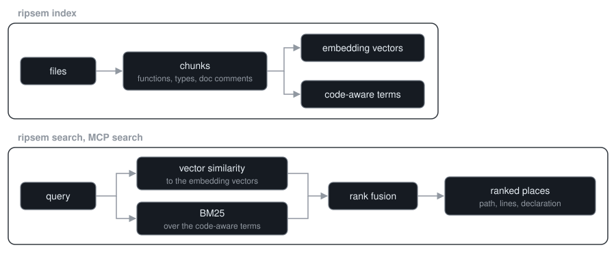

<h1 align="center">ripsem</h1>

<p align="center"><i>Where is the code that does this?</i></p>

<p align="center">
  <a href="https://github.com/Sadykhzadeh/ripsem/actions/workflows/ci.yml"></a>
  <a href="https://github.com/Sadykhzadeh/ripsem/releases/latest"></a>
  <a href="LICENSE"></a>
</p>

<p align="center">
  <a href="#get-started">Get started</a> ·
  <a href="#usage">Usage</a> ·
  <a href="#use-with-coding-agents">Coding agents</a> ·
  <a href="#how-it-works">How it works</a> ·
  <a href="#troubleshooting">Troubleshooting</a>
</p>

<p align="center">
  <picture>
    <source media="(prefers-color-scheme: light)" srcset="https://github.com/Sadykhzadeh/ripsem/raw/HEAD/docs/demo/search-light.gif">
    
  </picture>
</p>

ripsem is local, offline code search for people and for coding agents. Ask with
an identifier, an error message or a plain description of the behaviour, and get
back the functions and types that answer it, ranked, with their names and line
ranges.

- **Every shape of question in one query.** BM25 over code-aware tokens and
  vector similarity from a local embedding model, merged into one ranking. A
  chunk holding every term of an identifier or an error message comes first.
- **Answers are declarations.** A hit is a whole function or type, named after
  it, in 17 languages, so a definition reads apart from a call site. A search
  for a name lands on its declaration, with its own lines and label.
- **Made for coding agents.** `ripsem install claude-code` or `ripsem install
  cursor` adds an MCP server that keeps its index current while the agent edits,
  and tells the agent when to use it.
- **Offline.** No account, no API key, no service. The model downloads once and
  runs on your CPU, and the index is one file inside your repository.

## Get started

1. Install ripsem:

    **npm (any platform):**
    ```bash
    npm install -g ripsem
    ```

    **Cargo:**
    ```bash
    cargo install --locked ripsem
    ```

    **macOS and Linux, without npm or Rust:**
    ```bash
    curl -fsSL https://raw.githubusercontent.com/Sadykhzadeh/ripsem/master/install.sh | sh
    ```

    **Windows, without npm or Rust:**
    ```powershell
    irm https://raw.githubusercontent.com/Sadykhzadeh/ripsem/master/install.ps1 | iex
    ```

2. In your repository, ask it something:

    ```bash
    ripsem search "strip the auth header when redirecting to another host"
    ```

3. Hand the same search to your coding agent with `ripsem install claude-code` or
   `ripsem install cursor` (see [below](#use-with-coding-agents)).

The first search in a git repository builds the index: it downloads the model
(~32 MB) once and embeds the repository, which takes seconds. Every search
after that first embeds whatever changed since, so results never point at code
that has moved. With one of the transformer models from [Models](#models), the
first index on Windows runs on the GPU through DirectML when there is one.

### Why not grep?

grep answers "where does this string occur". That is the right question when you
know the string. ripsem is for when you know what the code does but not what it
is called: a description finds the function, and an identifier or an error
message still finds its exact match, because the lexical arm sees it
literally. Each hit is a whole function or type with its name, not a matching
line, so a reader or an agent can tell a definition from a call site without
opening the file.

## Install

npm and the install scripts put the prebuilt binary from the latest
[release](https://github.com/Sadykhzadeh/ripsem/releases) on your `PATH`, after
checking it against the release's `SHA256SUMS`. The scripts install to
`~/.local/bin` and `%LOCALAPPDATA%\Programs\ripsem`; `RIPSEM_INSTALL_DIR`
overrides that. The release archives can also be unpacked by hand; on Windows,
keep `DirectML.dll` next to `ripsem.exe`.

| platform | runs on |
| --- | --- |
| `x86_64-unknown-linux-gnu` | glibc 2.35, libstdc++ 12 and OpenSSL 3 or newer: Ubuntu 22.04, Debian 12 and later |
| `aarch64-apple-darwin` | macOS 13.4 or newer on Apple silicon |
| `x86_64-pc-windows-msvc` | Windows 10 or newer with the [Microsoft Visual C++ Redistributable](https://learn.microsoft.com/cpp/windows/latest-supported-vc-redist) |

The embedding runtime in the x86-64 builds needs a CPU with AVX2 (Intel
Haswell, AMD Excavator or newer). The binaries are built with the embedding
runtime and tree-sitter; the model itself downloads on first use.

`cargo install` builds from source, with Rust 1.90 or newer. The build
downloads a prebuilt ONNX Runtime, and needs a C and C++ compiler, plus
pkg-config and the OpenSSL headers on Linux (`build-essential pkg-config
libssl-dev` on Debian and Ubuntu).

Tagged releases are the stable versions, and npm, Cargo and the install scripts
all install the latest one. `master` carries the changes for the next release,
listed under Unreleased in [CHANGELOG.md](CHANGELOG.md).

To build the latest release from a checkout:

```
git clone https://github.com/Sadykhzadeh/ripsem
cd ripsem
git checkout "$(git describe --tags --abbrev=0)"
cargo install --locked --path .
```

Leaving out the `git checkout` builds `master`.

The `fastembed` feature, on by default, pulls in the local embedding runtime.
Built with `--no-default-features`, ripsem runs on a lightweight hashing backend
that matches words instead of meaning, which is what the test suite uses.

The `treesitter` feature, also on by default, chunks code on function and type
boundaries instead of fixed line windows, and names each chunk after the
declaration it belongs to. Results look like `src/auth/session.rs:40-72 fn
Session::refresh`, so a caller can tell a definition from a call site without
opening the file. A function too large for one chunk passes its name to every
piece. It covers Rust, Python, JavaScript, TypeScript, Go, Java, C, C++, C#,
Ruby, PHP, Scala, Kotlin, Bash, HTML, CSS and JSON; other files are cut into
line windows.

The `hnsw` feature adds an approximate-nearest-neighbour graph for indexes above
500 000 chunks. It changes only how the vector arm gathers candidates; the
lexical arm and the merge work the same at any size.

### Shell completions

```
ripsem completions bash > ~/.local/share/bash-completion/completions/ripsem
ripsem completions zsh > ~/.zfunc/_ripsem
ripsem completions fish > ~/.config/fish/completions/ripsem.fish
ripsem completions powershell >> $PROFILE
```

## Usage

```
ripsem init                       # write .ripsem/config.toml
ripsem index                      # build the index (incremental on re-runs)
ripsem search "where is auth set up?"   # updates the index first
ripsem status                     # index size, counts, model, drift from the tree
ripsem status --json              # the same as JSON (schema ripsem/status/v1)
ripsem watch                      # keep the index in sync as files change
```

Like git, every command except `init` works from any subdirectory: it uses the
nearest parent that holds a `.ripsem` directory. `--path <dir>` overrides that.

The index stays out of git: `.ripsem/.gitignore` lists it, so `git status`
shows only `config.toml` (which can be committed) and that `.gitignore`. ripsem
writes the file when it is missing and never changes an existing one.

`status` also reports how far the index has drifted from the files. Hits carry
the line range their file had when it was indexed, so `tree: out of date: 3
changed, 1 new` tells you when a result may no longer point at the right lines.
Drift is measured with the same content hash the incremental index uses, so it
counts exactly what a rebuild would touch. The JSON carries it as `index.drift`
(`added`/`modified`/`removed`).

Results print as `path:start-end` with the declaration's name and a snippet, in
merged-ranking order. The first three hits carry their code, up to 40 lines,
so the answer can be read without opening the file. Records that cover the same lines (a declaration and the
documentation above it, or adjacent windows) are returned once, so `-k 5` means
five distinct places. The number shown runs from 0 to 1: how far the hit's
meaning rises above unrelated text in this repository, or the share of the
query's terms found literally, whichever is higher. It never rises down the
list, so a threshold keeps the top of the ranking. Each index measures its own
noise floor by matching queries about anything but code against it, so the
scale follows the repository and the model.

- `-k <N>` sets the number of results (default 10).
- `--json` prints machine-readable output.
- `--in <subdir>` limits results to a subdirectory (`./src/auth` and an absolute
  path into the repository mean the same).
- `--context <N>` sets how many snippet lines print per hit (3 in a terminal,
  the whole snippet when the output goes to another program; `0` prints just
  the locations).
- `--min-score <SCORE>` keeps only strong matches, in both human and JSON output.
- `--count-by-file` prints hit counts per file instead of the hits.

## Models

```
ripsem model list                 # show available models
ripsem model set bge-base-en-v1.5
ripsem index                      # rebuilds the index for the new model
```

| Model | Dims | Disk | Notes |
| --- | --- | --- | --- |
| potion-code-16M-v2 | 256 | ~32 MB | default; static code model: indexes in seconds, without the ONNX runtime |
| bge-small-en-v1.5 | 384 | ~133 MB | general English model |
| all-MiniLM-L6-v2 | 384 | ~90 MB | smallest and fastest of the transformer models |
| bge-base-en-v1.5 | 768 | ~436 MB | larger English model |
| multilingual-e5-small | 384 | ~470 MB | queries and comments in other languages |
| nomic-embed-text-v1.5 | 768 | ~550 MB | larger English model, the most memory to index |

The model downloads once on first use, then everything is offline.

## Use with coding agents

<p align="center">
  <picture>
    <source media="(prefers-color-scheme: light)" srcset="https://github.com/Sadykhzadeh/ripsem/raw/HEAD/docs/demo/setup-light.gif">
    
  </picture>
</p>

```
ripsem install claude-code        # .mcp.json and a note in CLAUDE.md
ripsem install cursor             # .cursor/mcp.json and a rule in .cursor/rules
```

`install` registers the server, writes `.ripsem/config.toml`, and adds a short
note that tells the agent to reach for `search` before grepping. Restart the
agent in the directory and it can call `search` directly.

The server sends the same note as its MCP instructions. Claude Code loads the
descriptions of MCP tools only when the model looks a tool up, so the model
learns that `search` exists, and when to use it, from the instructions and the
note in `CLAUDE.md`.

`ripsem mcp` speaks MCP over stdio and exposes a single `search` tool: a
`query`, and optionally a `path` to stay inside, a `limit` (default 5, at most
50) and a `min_score`. An argument outside the schema comes back as a tool
error that names what is expected, so the agent can correct the call. In a
directory with a `.ripsem` directory the server keeps the index current by
itself: it builds the index on its first start and re-embeds the code the
agent changes. Running `ripsem index` once beforehand has the index ready
before the first search.

Any other MCP client takes the same entry in its own config:

```json
{
  "mcpServers": {
    "ripsem": { "command": "ripsem", "args": ["mcp"] }
  }
}
```

Without ripsem installed, the client can start it through npm with
`"command": "npx", "args": ["-y", "ripsem", "mcp"]`.

The server finds the index from the directory it starts in. To point it at a
repository elsewhere, add `"--path", "/path/to/repo"` to `args`; `install
cursor` writes `"--path", "${workspaceFolder}"`, which Cursor expands to the
project. A client that shares its workspace roots, such as one that starts the
server from the home directory, points it at the project itself, and `--path`
overrides them.

## Configuration

`.ripsem/config.toml`:

```toml
backend = "fastembed"
model = "potion-code-16M-v2"
chunk_lines = 40
chunk_overlap = 8
max_chunk_lines = 50
max_file_kb = 1024
skip_generated = true
exclude = []
```

`chunk_lines` and `chunk_overlap` size the line windows used for plain-text
files and languages without a parser. `max_chunk_lines` caps a single semantic
chunk; larger functions are split. After changing any of the three, the next
`ripsem index` chunks and embeds every file again. Files larger than
`max_file_kb` are skipped. `exclude` takes gitignore-style globs, on top of
`.gitignore` and an optional `.ripsemignore`. `backend = "hash"` matches words
instead of meaning; builds without the `fastembed` feature start with it. A key
ripsem does not know is reported as an error.

`skip_generated` leaves out files that are committed but written by a machine:
lock files, `go.sum`, `*.min.js`, `*.min.css` and source maps. `.gitignore`
does not cover them because they are committed on purpose, and a single lock
file can outweigh everything written by hand. Set it to `false` to index them
anyway.

## How it works

<p align="center">
  <picture>
    <source media="(prefers-color-scheme: light)" srcset="https://github.com/Sadykhzadeh/ripsem/raw/HEAD/docs/how-it-works-light.svg">
    
  </picture>
</p>

1. **Walk.** The tree is read the way git sees it: `.gitignore`, the global
   gitignore and `.ripsemignore` apply, and binary files, files above
   `max_file_kb` and machine-written files are left out.
2. **Chunk.** tree-sitter cuts each file at function and type boundaries and
   names every chunk after its declaration. A doc comment or docstring becomes a
   second record for the same declaration, because an author describes code in
   words the code itself rarely uses.
3. **Embed and tokenise.** Each chunk gets a vector from the local model,
   stored as int8, and a set of terms in which identifiers are kept whole and
   also split at `snake_case` and `camelCase` boundaries. Every chunk also
   lists the declarations it holds, with their lines.
4. **Search.** The query runs through both arms and their rankings are merged
   by reciprocal rank fusion. A chunk holding every informative term of the
   query comes first, which is what makes identifiers and error messages
   reliable. A query that names a declaration, typed as code or spelled out in
   words, puts the chunk declaring it above the chunks that only use it, and
   reports that declaration. Below that, code ranks above tests, unless the
   query asks for tests, and above prose that describes it.
5. **Keep up.** The index is one file, `.ripsem/index.bin`. A re-run reads only
   files whose content changed and embeds only the chunks whose text changed;
   a new model or new chunk settings rebuild it.
   `ripsem watch` keeps it current as files change, and the MCP server picks up
   a rebuilt index without a restart.

## Troubleshooting

**A file never shows up in results.** `ripsem index --dry-run` lists every file
the index takes in. A file is left out when `.gitignore`, `.ripsemignore` or
`exclude` matches it, when it is binary or larger than `max_file_kb`, or when
`skip_generated` treats it as machine-written.

**A result points at the wrong lines.** The file changed after it was indexed.
`ripsem search` updates the index before it searches, and `ripsem watch` or a
running MCP server keeps it current; `ripsem status` shows how far it has
drifted.

**Search says the index was built with another model.** The config names a
different model or backend than the index. `ripsem index` rebuilds it for the
config.

**The agent does not call `search`.** The server starts with the agent, so
restart the agent in the repository after `install`. In Claude Code, `/mcp`
lists the servers it has connected to.

**The first index takes a while.** It downloads the model once and embeds every
file, showing the chunks embedded so far and an estimate of the time left.
Every later run embeds only the code that changed. On Windows a job of 256
chunks or more runs on the GPU through DirectML, about four times faster than
on the CPU; `RIPSEM_NO_GPU=1` keeps it on the CPU, for example when a graphics
driver misbehaves. The model is cached in
`~/.cache/ripsem` on Linux, `~/Library/Caches/ripsem` on macOS and
`%LOCALAPPDATA%\ripsem\cache` on Windows.

**`ripsem.exe` fails to start on Windows.** A missing `VCRUNTIME140.dll` or
`MSVCP140.dll` means the Microsoft Visual C++ Redistributable is not installed:
`winget install Microsoft.VCRedist.2015+.x64` adds it. A missing `DirectML.dll`
means it was not kept next to `ripsem.exe` when the archive was unpacked.

## Quality

Ranking is held to a benchmark of labelled questions over four real projects in
four languages (Rust, Python, Go and TypeScript), each pinned at a release tag.
The questions come in the four shapes people actually search with: a
description in their own words, an identifier, a message seen in output, and a
name remembered wrong. The merged ranking has to beat either retriever alone,
put the answer in the top five for at least 86% of the questions, and cost less
to read up to the answer than the file the answer is in. A second test searches
for every name declared once in those projects: the first hit has to be that
declaration, under its own name, for at least 95% of them, and no hit on a
declaration's lines may carry another name.

```
cargo test --release --test retrieval_quality -- --ignored --nocapture \
  fusion_beats_either_retriever_alone a_declared_name_leads_to_its_declaration
```

The first run clones the four projects into `target/corpora` and downloads the
model. [CONTRIBUTING.md](CONTRIBUTING.md) describes how a change to ranking is
measured.

## License

Apache-2.0
